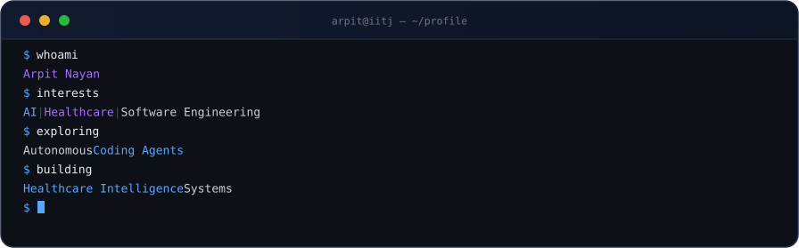

<div align="center">

<picture>
  <source media="(max-width: 560px)" srcset="assets/header-hero-mobile.svg"/>
  
</picture>

<br/>

<a href="https://github.com/arpitnayan123-bot/arpitnayan123-bot/blob/main/ASSETS.md">
  
</a>

<br/>


&nbsp;

&nbsp;

&nbsp;


</div>


## About


```ts
const arpit: Builder = {
  studying: [
    "IIT Jodhpur — BS in Management & Technology",
    "IIT Madras — BS in Data Science and Applications",
  ],
  building: ["Nexura OS", "REA — coding agent", "Medulla"],
  exploring: [
    "healthcare AI",
    "personal health memory",
    "software intelligence",
  ],
  mindset: "learn relentlessly · build honestly · iterate",
  openTo: ["AI products", "dev tools", "healthcare tech"],
};
```

- 🎓 I study at **IIT Jodhpur** (BS in Management & Technology) and **IIT Madras** (BS in Data Science and Applications) — one degree for how systems are built, the other for how data explains them.
- 🛠 I spend most of my time **building**: **Nexura OS**, a healthcare operating system; **REA**, my own AI coding agent; and **Medulla**, a learning platform for medical students.
- 🔭 I like understanding software from the inside — reading real codebases, reverse-engineering architectures, and crediting the open-source projects I learn from.
- 🧭 Long-term, I want to build at the intersection of **AI, healthcare infrastructure, and software systems** — ambitious products that hold up outside the demo.
- 🤝 Always open to **meaningful technical collaboration** — especially AI products, developer tools, and healthcare technology.

<br clear="right"/>


## Flagship Projects

<div align="center">
  <i>What I'm building — honestly labeled by status. Everything real, nothing inflated.</i>
</div>

<br/>

<table>
<tr><td valign="top">

### ◆ Nexura OS &nbsp;·&nbsp; Healthcare Operating System

> Clinics, pharmacies, and patient experiences today run on disconnected software — Nexura OS connects them on one platform.

An integrated healthcare operating system linking clinical workflows, pharmacy operations, patient portals, and AI-assisted health tools on a shared platform layer. This is my primary project — where I'm learning what it actually takes to design, build, and operate a serious multi-product system.


[**→ repository**](https://github.com/arpitnayan123-bot/Nexura-OS) &nbsp;·&nbsp; [**→ live preview**](https://nexura-os.space-z.ai)

</td></tr>
</table>

<table>
<tr><td valign="top">

### ◆ REA &nbsp;·&nbsp; AI Coding Agent &nbsp;·&nbsp; Software Intelligence

> Autonomous coding agents are reshaping software engineering — I want to understand how they work, not just use them.

I study real open-source software-engineering systems to understand their architecture, then build my own extensible coding agent — crediting the projects I learn from. Reverse engineering is how I teach myself systems thinking. This is the most demanding thing I'm working on, and the one I think about most.


*Repository is private while the foundation sets — happy to walk through the design.*

</td></tr>
</table>

<table>
<tr><td valign="top">

### Medulla &nbsp;·&nbsp; Medical Learning OS

> Medical students drown in scattered resources — Medulla turns the curriculum into one connected map.

A learning platform for medical students: a knowledge map of the MBBS curriculum, first-principles lessons, spaced revision, question practice, and clinical cases. Built to make medical learning organized and interactive rather than fragmented.


[**→ repository**](https://github.com/arpitnayan123-bot/Medula)

</td></tr>
</table>

<table>
<tr><td valign="top">

### Personal Health Twin & Health Memory

> A person's health history is usually a pile of reports and half-remembered details — not something you can actually read.

An exploratory consumer-health concept: a longitudinal personal health memory that organizes records, signals, and notes over time, gradually forming a personal health representation that helps people see what is changing and why. Currently in research and design — no code published yet, by design.


</td></tr>
</table>

<table>
<tr><td valign="top">

### IIT Founder & Builder Network &nbsp;·&nbsp; Conclave

> Serious student builders need a room without noise.

The early implementation of my IIT-focused founder-network idea: an invite-only space where entrepreneurial students share what they're building, review each other's work, and meet potential collaborators through a review-and-invitation process.


[**→ repository**](https://github.com/arpitnayan123-bot/Conclave)

</td></tr>
</table>


## Currently Building

<div align="center">
  
</div>

Beyond the flagships, these are live experiments I'm learning from:

| &nbsp; | Project | Status | What it explores |
| --- | --- | --- | --- |
| 🧪 | [Aarogya AI](https://github.com/arpitnayan123-bot/AAROGYA-AI) | Experiment | AI health-intelligence platform — lab analysis, Ayurveda, ABDM-aligned health records · [live preview](https://aarogya-ai.space-z.ai) |
| 🧪 | [Sanket](https://github.com/arpitnayan123-bot/Sanket) | Prototype | Doctor's consultation voice → FHIR clinical note → voice reminders for patients, aligned with India's ABDM |


## Stack & Learning

<div align="center">

**used in my projects**


<br/><br/>

**currently learning**


<br/><br/>

**areas of exploration**


</div>


## GitHub Analytics

<div align="center">
  <a href="https://github.com/arpitnayan123-bot" title="Repositories per language">
    
  </a>
  <a href="https://github.com/arpitnayan123-bot" title="Productive time">
    
  </a>
</div>

<br/>

<div align="center">
  
</div>


## 3D Contribution Calendar

<div align="center">
  <picture>
    <source media="(prefers-color-scheme: dark)" srcset="https://raw.githubusercontent.com/arpitnayan123-bot/arpitnayan123-bot/main/profile-3d-contrib/profile-blueviolet.svg"/>
    <source media="(prefers-color-scheme: light)" srcset="https://raw.githubusercontent.com/arpitnayan123-bot/arpitnayan123-bot/main/profile-3d-contrib/profile-season-animate.svg"/>
    
  </picture>
</div>


## Contribution Snake

<div align="center">
  <picture>
    <source media="(prefers-color-scheme: dark)" srcset="https://raw.githubusercontent.com/arpitnayan123-bot/arpitnayan123-bot/output/github-contribution-grid-snake-dark.svg"/>
    
  </picture>
</div>


## Let's Build Together

<div align="center">
